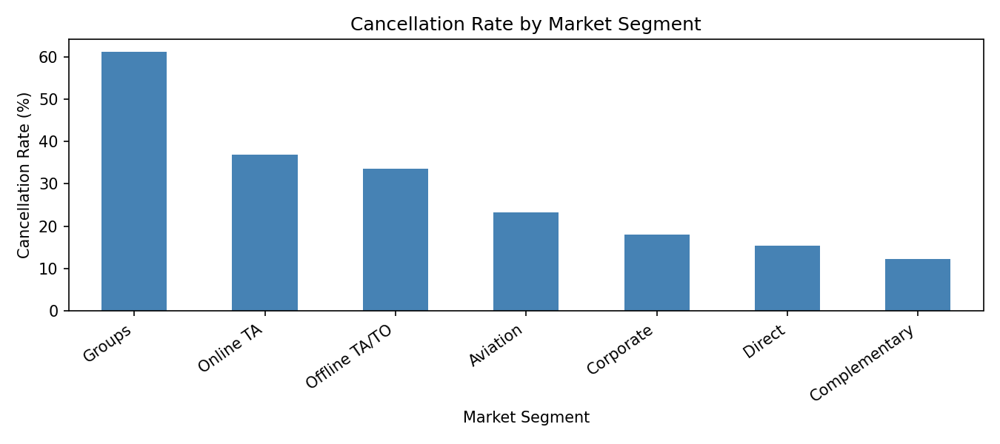
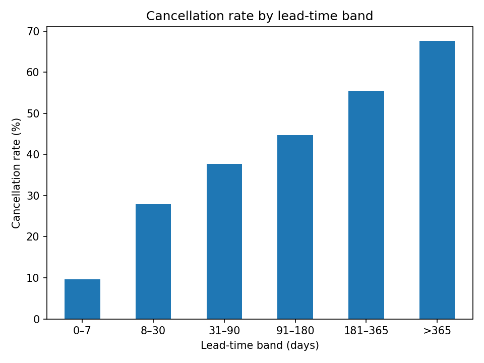

# HOTEL BOOKING DEMAND

## Cancellation Risk Prediction

**IT3091 Machine Learning — Final Group Report**  
**Group:** 76  
**Track:** Guided Data Track  
**Domain:** Tourism and Hospitality  
**Primary decision lens:** Cancellation risk  
**Machine learning task:** Binary classification

---

## Executive Summary

Hotel booking cancellations complicate occupancy forecasts, revenue planning and operational resource allocation. Group 76 developed a booking-level binary classifier to estimate cancellation risk from reservation characteristics, with predictions intended for hotel revenue management and operations teams rather than automatic decisions about guests.

Using the *Hotel Booking Demand* dataset, the project validated 119,210 of 119,390 original records and selected 21 input features for predicting `is_canceled`. A group-aware holdout divided the validated dataset into 95,334 training and 23,876 test records. Models were evaluated using preprocessing pipelines and five-fold `StratifiedGroupKFold` cross-validation. A Dummy Classifier baseline was compared with Logistic Regression, Decision Tree, Random Forest and Gradient Boosting.

A tuned Random Forest had the strongest five-fold precision–recall area under the curve (PR-AUC, **0.8420**) among the evaluated configurations. Its default-threshold recall was modest, so cancellation-risk thresholds were compared using out-of-fold training predictions. A threshold of **0.40** gave the strongest observed F1-score among the tested Random Forest thresholds and exceeded the tuned Decision Tree’s best observed F1-score in the same threshold search.

With model and threshold fixed, the Random Forest achieved **79.39% accuracy, 71.37% precision, 74.86% recall, F1 = 0.7307, ROC-AUC = 0.8857 and PR-AUC = 0.8434** on the held-out test set. It correctly identified 6,676 cancellations, missed 2,242 and produced 2,678 false alerts. A supplementary experiment showed that removing exact duplicates during training materially changed performance, but could not establish whether repeated records represented separate bookings or extraction errors. The recommended use is carefully supervised reservation monitoring and planning, subject to future-period, fairness and cost validation.

## 1. Business Problem, Stakeholders and Task

### 1.1 Decision context

A confirmed hotel reservation does not guarantee an occupied room. Late or unexpected cancellation can affect forecast occupancy, potential revenue, room availability, staffing and preparation of hotel services. Revenue and operations teams therefore need an earlier indication of which bookings may cancel. Booking-system administrators and senior hotel management are secondary users of aggregated risk information.

The group chose **cancellation risk** as its single primary decision lens. Customer segmentation was considered but would answer a different question; operational planning was retained as an application of cancellation-risk estimates, not as a second modelling objective. This kept the technical task focused and the business value explicit.

### 1.2 Prediction objective

**Business question:** Can information reasonably available at booking confirmation identify hotel reservations at increased risk of later cancellation?

Each dataset row is treated as one recorded hotel booking. The target, `is_canceled`, equals **1** for a cancelled booking and **0** otherwise. The primary output is a binary cancellation-risk flag; the model also produces a probability-like score used to rank bookings and choose an alert threshold. The score should not be treated as a guaranteed outcome or, without further testing, as a perfectly calibrated probability.

The proposed system is **decision support**, not an automated booking rejection, penalty or cancellation system. Its operational objective is to make appropriate reservation follow-up and aggregate planning more informed.

## 2. Dataset Understanding and Exploratory Analysis

### 2.1 Data source and structure

The dataset is the public *Hotel Booking Demand* dataset made available on Kaggle, originally described by António, de Almeida and Nunes (2019). It contains historical records from a city hotel and a resort hotel. Its **119,390 rows and 32 columns** include booking timing, duration, guests, booking channels, accommodation characteristics and final reservation outcome. A detailed variable-level data dictionary is maintained in `docs/data_dictionary.md`.

| Dataset stage | Records | Columns | Purpose |
|---|---:|---:|---|
| Original source | 119,390 | 32 | Dataset understanding and cleaning |
| Validated dataset | 119,210 | 32 | Subsequent modelling and split |
| Development/training partition | 95,334 | 32 | EDA for model development, cross-validation and tuning |
| Held-out test partition | 23,876 | 32 | Final independent evaluation |

The original outcome distribution was **75,166 non-cancellations (62.96%)** and **44,224 cancellations (37.04%)**. In the training partition, 35,281 bookings (37.01%) were cancelled and 60,053 (62.99%) were not. This is a moderately imbalanced task, supporting the use of precision, recall, F1 and PR-AUC alongside accuracy.

### 2.2 Key EDA findings

The EDA notebooks recorded several patterns relevant to the task:

- **Hotel type:** In the validated training partition, the City Hotel had **63,400 bookings and a 41.6% cancellation rate**, versus **31,934 bookings and 28.0%** for the Resort Hotel.
- **Market segment:** Group reservations had a **61.1% cancellation rate** (16,078 records), compared with **36.9%** for Online TA, **33.6%** for Offline TA/TO, **18.1%** for Corporate and **15.3%** for Direct bookings. These are historical associations, not evidence that the booking channel causes cancellation.
- **Lead time:** In the original dataset, cancelled bookings had a **median lead time of 113 days**, compared with **45 days** for bookings that were not cancelled. The cancellation rate increased across the lead-time bands investigated in the numerical EDA.
- **Arrival month:** In the training partition, selected cancellation rates were **41.5% in June**, **40.4% in May**, **40.1% in April** and **30.4% in November**; August had the highest volume (11,159 training bookings).

These observations supported the inclusion of `hotel`, `lead_time`, `market_segment`, arrival-date variables and previous booking history among the candidate inputs. EDA was used for interpretation and feature justification, not for causal claims. The earliest dataset-structure and numerical EDA notebooks examined the raw dataset, whereas categorical/time EDA used the training subset; accordingly, not every exploratory analysis was isolated from records later assigned to the test partition. The held-out outcomes were not used to choose the final model or threshold.

## 3. Data Quality, Cleaning and Feature Strategy

### 3.1 Cleaning decisions

The original dataset contained four missing `children` values, 488 missing `country` values, 16,340 missing `agent` values and 112,593 missing `company` values. Targeted cleaning replaced missing `children` with zero, labelled missing `country` as `Unknown`, and removed **180 bookings with no adults, children or babies**. `agent` and `company` were retained in the validated intermediate dataset but excluded from model inputs. One negative `adr` value was documented but retained in the validated dataset because `adr` was not used for modelling.

Exactly **31,994 rows duplicated an earlier row across all 32 source columns**. A missing unique reservation ID prevents determining whether those rows represent separate bookings with the same recorded attributes or extraction errors. The primary analysis retained them to preserve the published record distribution. This choice was **not** assumed to prove the records were genuine; it was investigated separately through sensitivity analysis (Section 8).

### 3.2 Prediction-time feature availability and leakage prevention

The operational prediction boundary was set at **booking confirmation**. The target was excluded from the predictors. Two fields, `reservation_status` and `reservation_status_date`, directly disclose final outcome information and were therefore excluded. Eight further fields—`assigned_room_type`, `booking_changes`, `deposit_type`, `agent`, `company`, `adr`, `required_car_parking_spaces` and `total_of_special_requests`—were excluded based on prediction-time availability concerns, potential leakage or scope decisions; they were not all proven to be leaky.

This left **21 approved predictors**, consisting of **13 numerical and 8 categorical** fields. Examples include hotel, lead time, arrival details, lengths of stay, guest counts, meal plan, reserved room category, country, market segment, distribution channel, customer type, repeat-guest status, previous cancellation history and waiting-list days.

### 3.3 Shared preprocessing and feature engineering

A shared scikit-learn `ColumnTransformer` in `src/preprocessing/pipeline.py` applies **median imputation and `StandardScaler`** to numerical features, and **most-frequent imputation and `OneHotEncoder(handle_unknown="ignore")`** to categorical features. This preprocessor is embedded inside each classification pipeline, ensuring it is fitted on the training portion of each validation fold. Although scaling is not essential to tree algorithms, using a common pipeline simplified consistent comparison.

The candidate engineered features `total_nights` and `total_guests` were explored but not adopted in the main comparison because they were strongly redundant with their constituent variables. The observed training imbalance was left intact; oversampling/SMOTE was not applied. Class-weight alternatives were explored during tuning where supported.

## 4. Experimental Design and Modelling

### 4.1 Holdout and validation

A saved approximately **80/20 group-aware holdout** used 95,334 records for model development and 23,876 for final evaluation. Groups were constructed by hashing complete combinations of the **21 approved input features**. Verification confirmed **no row-index overlap, full coverage of validated records, and no shared feature-combination groups** across train and test partitions. Within training, five-fold `StratifiedGroupKFold` (shuffle enabled, `random_state=42`) was used for model evaluation.

This reduces leakage from identical observed predictor combinations and separates preprocessing fit from validation. It does not create a chronological forecast test or eliminate every form of data dependence. The test partition was reserved for one final evaluation after model and threshold selection.

### 4.2 Baseline and alternatives

Five classification approaches were studied: **Dummy Classifier** (`strategy='prior'`), **Logistic Regression**, **Decision Tree**, **Random Forest** and **Gradient Boosting**. The dummy baseline quantifies what is achieved without useful discrimination; Logistic Regression offers a comparatively simple linear benchmark; the tree provides interpretable decision rules; Random Forest captures nonlinear interactions through an ensemble; and Gradient Boosting offers a sequentially improved tree ensemble.

Model development compared **accuracy, precision, recall, F1-score, ROC-AUC and PR-AUC**. PR-AUC was the hyperparameter search objective because cancellations were the minority class and identifying true cancellations without excessive false alerts mattered. Recall and F1-score were examined separately for their practical implications.

### 4.3 Hyperparameter tuning

Limited searches used **three-fold group-aware cross-validation** within the training partition. Logistic Regression used a small grid over regularization `C` and class weighting; Decision Tree tested depth, minimum leaf size and class weighting; Random Forest tested six sampled configurations; Gradient Boosting tested four sampled configurations. The limited searches were appropriate for available computing resources, and the results describe the **best of the tested configurations**, not a global optimum.

| Model | Retained configuration after tuning | Reason |
|---|---|---|
| Logistic Regression | `C=1`, `class_weight=None` | Original settings selected again |
| Decision Tree | `max_depth=16`, `min_samples_leaf=30`, `class_weight='balanced'` | Higher recall and F1 at default threshold |
| Random Forest | `n_estimators=100`, `max_depth=15`, `min_samples_leaf=5`, `class_weight=None` | Slightly higher PR-AUC among tested settings |
| Gradient Boosting | Original: `n_estimators=100` and original learning settings | Four-setting tuning candidate underperformed |

Because hyperparameter selection and subsequent five-fold comparison were performed on the same development partition, those five-fold scores support **internal model selection**, not a completely unbiased estimate of the selected model's performance. The separate holdout supplied that final estimate.

## 5. Model Comparison and Final Selection

### 5.1 Five-fold cross-validation results

The table below reports mean validation metrics for the retained configuration of each model at the **default classification threshold (0.50)**, except the non-predictive dummy baseline.

| Model | Accuracy | Precision | Recall | F1 | ROC-AUC | PR-AUC |
|---|---:|---:|---:|---:|---:|---:|
| Dummy Classifier | 0.6302 | 0.0000 | 0.0000 | 0.0000 | 0.5000 | 0.3698 |
| Logistic Regression | 0.7774 | 0.7541 | 0.5909 | 0.6622 | 0.8421 | 0.7906 |
| Decision Tree (tuned) | 0.7656 | 0.6514 | **0.7907** | **0.7135** | 0.8704 | 0.8177 |
| Random Forest (tuned) | **0.7883** | **0.8891** | 0.4881 | 0.6301 | **0.8845** | **0.8420** |
| Gradient Boosting (original) | 0.7844 | 0.8213 | 0.5331 | 0.6463 | 0.8655 | 0.8177 |

The tuned Decision Tree gave the highest default-threshold recall and F1-score; the tuned Random Forest gave the highest ROC-AUC and PR-AUC, but its default cutoff missed many cancellations. This motivated a **threshold analysis** rather than selecting a model solely from default-cutoff F1.

### 5.2 Development-data threshold analysis

Five-fold out-of-fold cancellation probabilities were generated for the tuned Random Forest and Decision Tree, using each model's shared preprocessing pipeline and the existing group-aware folds. Precision, recall and F1-score were compared across thresholds from **0.25 to 0.60**. The Random Forest reached its highest observed F1 at **0.40**, and the Decision Tree at **0.45**.

| Candidate / threshold | Precision | Recall | F1 |
|---|---:|---:|---:|
| Random Forest, 0.50 | 0.8898 | 0.4884 | 0.6306 |
| Random Forest, 0.40 | **0.7225** | 0.7452 | **0.7337** |
| Random Forest, 0.35 | 0.6379 | **0.8571** | 0.7315 |
| Decision Tree, 0.45 | 0.6284 | 0.8291 | 0.7149 |

The selection of **tuned Random Forest, threshold = 0.40** balanced cancellation detection with the number of false alerts for the chosen F1-based objective. A threshold of 0.35 could be considered if recall were the overriding operational priority, but would involve more false alerts. The threshold of 0.40 was fixed **before** using the test set. Since thresholds were chosen from the same out-of-fold development predictions used to compare their F1-scores, those development scores contain some selection optimism; the held-out results are the more reliable summary.

## 6. Independent Held-Out Test Evaluation

The selected Random Forest was refitted to **all 95,334 training bookings** using the fixed hyperparameters. Its probabilities were converted to cancellation alerts with the previously selected **0.40 threshold**, and the 23,876 held-out records were evaluated once.

| Test metric | Result |
|---|---:|
| Accuracy | **0.7939** |
| Precision | **0.7137** |
| Recall | **0.7486** |
| F1-score | **0.7307** |
| ROC-AUC | **0.8857** |
| PR-AUC | **0.8434** |

| Actual outcome | Predicted non-cancellation | Predicted cancellation |
|---|---:|---:|
| Not cancelled | **12,280** (TN) | **2,678** (FP) |
| Cancelled | **2,242** (FN) | **6,676** (TP) |

Of the **8,918 actual cancellations**, 6,676 were identified and 2,242 were missed (recall **74.86%**). Of the bookings predicted to cancel, **71.37%** actually cancelled (precision). The false-alert count of 2,678 matters operationally because unnecessary follow-up or intervention has a cost. Accuracy (79.39%) is useful context, but it does not capture that trade-off as clearly as precision and recall.

The test F1 (**0.7307**) was close to the selected development-data F1 (**0.7337**); test PR-AUC (**0.8434**) was close to the five-fold mean (**0.8420**). This supports performance stability on the available held-out partition, **not guaranteed future-period or cross-hotel generalization**. No threshold or hyperparameter adjustment was made after viewing the test outcome.

## 7. Model Interpretation

The fitted Random Forest's built-in impurity-based importance scores were combined across one-hot categories to summarize the importance of original input fields.

| Original input | Aggregated importance |
|---|---:|
| Country | 0.2500 |
| Market segment | 0.1615 |
| Lead time | 0.1575 |
| Customer type | 0.0941 |
| Previous cancellations | 0.0856 |
| Distribution channel | 0.0468 |
| Hotel type | 0.0275 |

The results suggest that booking origin/channel, reservation lead time and past cancellation activity were influential to the fitted model. The single highest encoded-category importance was `country_PRT` (**0.1753**). These **impurity-based** scores can favor variables with many categories and should not be treated as effect size, direction or causation. In particular, geographic patterns can reflect the dataset's market composition and should not justify unequal treatment of guests. Permutation importance and subgroup testing would provide useful further checks before deployment, but were not claimed as completed analyses.

## 8. Duplicate Sensitivity Analysis

The absence of unique reservation identifiers makes the **31,994 exact duplicate source rows** ambiguous. Group-aware splitting avoids placing the same approved input combination in both development and test data, but retaining repeated records may still affect model learning and the observed class distribution.

A supplementary **training-only** experiment used the same five group-aware validation folds and tuned Random Forest configuration for both approaches. In Approach A, all training-fold records were retained; in Approach B, exact duplicates were removed **within each training fold using all 32 recorded columns**. Each approach was evaluated on the **same unchanged validation rows** with cutoff 0.40. The final held-out test set was not used again.

| Mean validation metric | Keep duplicates | Remove duplicates |
|---|---:|---:|
| Precision | 0.7220 | **0.7745** |
| Recall | **0.7453** | 0.6076 |
| F1-score | **0.7333** | 0.6805 |
| PR-AUC | **0.8420** | 0.8223 |

Removing training duplicates improved precision but reduced recall, F1 and PR-AUC on the original validation distribution. The fixed **0.40 threshold** was originally selected for the retained-duplicate approach, so the two approaches were not separately threshold-optimized. Nor did the experiment evaluate them on an independently deduplicated population. It **demonstrates sensitivity**, not that retained duplicates are proven legitimate or deduplication is inherently wrong. The group therefore retained the original record distribution for its primary reported analysis and documented duplicate identity as an unresolved limitation.

## 9. Business Recommendations and Responsible Use

The primary stakeholder recommendation is to treat the model as a **prioritization signal**, not an autonomous reservation-management rule. Potential uses include: (1) proportionate, non-discriminatory confirmation reminders for bookings flagged at higher risk; (2) aggregated risk estimates as a supplementary input to occupancy and expected-revenue planning; and (3) scenario-based staffing and room-readiness planning. Hotel staff should retain authority over consequential decisions, and no booking should be cancelled, penalized or overbooked solely because of a model score.

Before any operational pilot, hotel management should measure the financial and service costs of **false positives** (unnecessary interventions) against **false negatives** (unanticipated cancellations), then verify whether the threshold of 0.40 suits actual business priorities. A controlled prospective test should examine performance on new bookings, assess score calibration, track alert workload and evaluate whether interventions improve measurable outcomes.

Important limitations include the use of historical booking data from a narrow hotel setting; lack of a chronological holdout; uncertainty about duplicate identity; no formal subgroup fairness assessment; no measured financial cost function; and possible drift in cancellation policies or booking markets. Because `country` and customer-related categories influence predictions, any use affecting individual guests requires particular scrutiny, privacy safeguards and human oversight.

## 10. Reproducibility and Project Evidence

The repository records cleaning, approved features, saved split indices, model search outcomes and final test results. The saved indices passed checks for **95,334/23,876 records, full dataset coverage, no overlapping indices and no shared 21-feature group hashes**. The model training environment documented by the group used `numpy==1.26.4`, `pandas==2.2.2`, `matplotlib==3.9.2` and `scikit-learn==1.5.1`. The raw and validated CSV SHA-256 checksums are recorded in `data/README.md`; their file contents were verified against the supplied repository snapshot.

**Main evidence paths** (relative to the repository root):

| Evidence | Repository path |
|---|---|
| Dataset dictionary | `docs/data_dictionary.md` |
| EDA insight log and figures | `docs/logs/eda_insight_log.md`; `results/eda/` |
| Decision record | `docs/logs/decision_log.md` |
| Cleaning / preprocessing | `notebooks/02_preprocessing/`; `src/preprocessing/pipeline.py` |
| Saved split | `results/splits/group_holdout_indices.npz` |
| Model notebooks | `notebooks/03_modelling/` |
| Final selection and test evaluation | `notebooks/04_final/final_group_notebook.ipynb` |
| Duplicate sensitivity experiment | `notebooks/04_final/duplicate_sensitivity.ipynb` |
| Metrics, including final test | `results/metrics/` |
| Recommendation and AI-use disclosure | `docs/recommendation/final_recommendation.md`; `docs/ai_use_declaration.md` |

For reproduction, obtain the dataset from the cited source, use compatible dependencies from `requirements.txt`, place data in the documented folders, and execute the cleaning, preprocessing, modelling and final notebooks in their documented order. The project folder `notebooks/01_data_understanding_eda/` holds the four EDA notebooks. A practical reproducibility check should use the recorded SHA-256 hashes before rerunning analyses. AI support was disclosed in the repository's AI-use declaration; responsibility for verification and interpretation remains with Group 76.

## 11. Conclusion

Group 76 formulated hotel cancellation risk as a practical binary-classification task and compared a baseline with four alternative algorithms under a consistent leakage-aware validation approach. The chosen tuned Random Forest, using a **0.40 alert threshold**, produced **0.7307 F1 and 0.8434 PR-AUC** on the held-out test data, with approximately **three quarters of cancellations detected**. Its value lies in supporting informed reservation follow-up and planning, not in automated actions against customers.

The investigation also identified limitations that matter for real deployment, especially duplicate-record ambiguity, dependence on historical market patterns, and the operational trade-off between missed cancellations and false alerts. Prospective validation, fairness assessment and business-cost analysis are needed before the model could be responsibly deployed.

## References

1. António, N., de Almeida, A., & Nunes, L. (2019). *Hotel booking demand datasets*. **Data in Brief, 22**, 41–49. https://doi.org/10.1016/j.dib.2018.11.126
2. Mostipak, J. *Hotel Booking Demand* [dataset]. Kaggle. https://www.kaggle.com/datasets/jessemostipak/hotel-booking-demand
3. IT3091 Machine Learning. *Group Assignment Descriptor, Version 1*. Course-provided assessment document.
4. Group 76. *Hotel Booking Demand — Cancellation Risk Prediction* project repository: notebooks, decision and EDA logs, preprocessing documentation, model comparison and final test metrics (October 2026).

---

**Submission note:** This report summarizes the completed group ML investigation. The final source notebooks/code, dataset or accessible dataset link, data dictionary, decision logs, model comparison, demonstration video, and individual Personal Learning Journey reports are separate required submission materials, as specified by the assignment descriptor.
